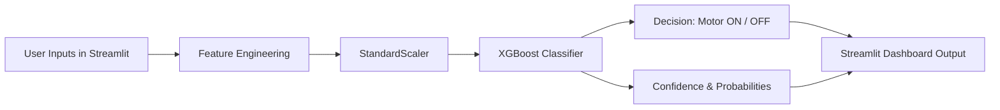

# 🌱 Smart Irrigation System — Machine Learning Prediction App

[](https://www.python.org/)
[](https://streamlit.io/)
[](https://xgboost.readthedocs.io/)
[](https://scikit-learn.org/)
[](LICENSE)

An end-to-end Machine Learning web application trained on the TARP agricultural dataset to predict whether irrigation is required based on soil and environmental parameters, helping prevent over-watering and optimize water usage.

---

## 📌 Overview

Traditional agricultural irrigation often relies on fixed timers or manual estimation, leading to substantial water waste or crop stress. This project provides an intelligent decision-support tool where users can input environmental parameters (soil moisture, temperature, soil humidity, and air temperature) to classify whether the irrigation pump should be switched **ON** or **OFF**.

The system features:
- **Trained ML Model**: Trained using an optimized **XGBoost Classifier** on historical agricultural data with non-linear feature engineering.
- **Interactive Web Interface**: A clean, responsive **Streamlit** dashboard for testing scenarios, receiving instant predictions, confidence metrics, and viewing probability distributions.
- **Domain Feature Engineering**: Automatically computes soil-environmental interaction terms to improve prediction quality.

---

## ⚙️ Architecture & Pipeline



1. **Input Parameters**: Soil moisture, temperature, soil humidity, and ambient air temperature entered via the web UI.
2. **Feature Engineering**: Cross-feature interaction terms (`moisture × temperature` and `moisture × humidity`) are computed dynamically to capture transpiration dynamics.
3. **Feature Scaling**: Normalized via `StandardScaler` to maintain numerical consistency with training data.
4. **Inference**: Evaluated against the trained XGBoost model.
5. **Prediction Output**: Displays binary recommendation (`Motor ON` vs `Motor OFF`) along with confidence percentage and probability breakdown.

---

## 📊 Model Performance

| Metric | Score / Detail |
| :--- | :--- |
| **Algorithm** | Extreme Gradient Boosting (`XGBClassifier`) |
| **Dataset** | TARP Agricultural Dataset (`dataset/TARP.csv`) |
| **Model Accuracy** | **73.1%** on held-out test split |
| **Estimators** | 200 trees (`max_depth=5`, `learning_rate=0.1`) |
| **Target Variable** | Binary Status (`1: Motor ON`, `0: Motor OFF`) |
| **Features Used** | 4 raw environmental variables + 2 engineered interaction features |

---

## 📂 Project Structure

```
smart-irrigation-system/
│
├── dataset/
│   └── TARP.csv              # Environmental dataset (TARP)
│
├── model/
│   ├── xgb_model.pkl         # Serialized XGBoost model
│   └── scaler.pkl            # Fitted StandardScaler instance
│
├── app.py                    # Streamlit interactive web application
├── train.py                  # Data preprocessing, training & evaluation pipeline
├── requirements.txt          # Python dependencies
└── README.md                 # Project documentation
```

---

## 🚀 Quick Start

### 1. Clone the Repository
```bash
git clone https://github.com/your-username/smart-irrigation-system.git
cd smart-irrigation-system
```

### 2. Create and Activate a Virtual Environment
```bash
# Windows
python -m venv venv
venv\Scripts\activate

# macOS / Linux
python3 -m venv venv
source venv/bin/activate
```

### 3. Install Dependencies
```bash
pip install -r requirements.txt
```

### 4. Launch the Web Application
```bash
streamlit run app.py
```
Open your browser at `http://localhost:8501` to view and interact with the application.

---

## 🔄 Retraining the Model

To retrain the model with updated hyperparameters or an expanded dataset:

```bash
python train.py
```

This will:
1. Ingest and clean `dataset/TARP.csv`.
2. Compute interaction features (`moisture_temp`, `moisture_humidity`).
3. Train the `XGBClassifier` and print the accuracy, classification report, confusion matrix, and feature importances.
4. Automatically export the updated model files to the `model/` directory.

---

## 🧪 Sample Scenarios

| Scenario | Soil Moisture | Soil Humidity | Temp | Air Temp | Predicted Status | Recommendation |
| :--- | :---: | :---: | :---: | :---: | :---: | :---: |
| **Dry & Hot** | 10 | 20% | 38°C | 36°C | **Motor ON (1)** | 💧 Irrigation recommended |
| **Moist & Cool** | 75 | 80% | 22°C | 20°C | **Motor OFF (0)** | ✅ Soil sufficiently hydrated |

---

## 🔮 Future Improvements

- [ ] **Weather API Integration**: Ingest precipitation forecast data (e.g. OpenWeatherMap) to adjust irrigation advice.
- [ ] **Multi-crop Profiles**: Configurable thresholds tailored for specific crop species (e.g., tomatoes, wheat, rice).
- [ ] **Historical Analytics**: SQLite / PostgreSQL logging with time-series trends in Streamlit.
- [ ] **Model Comparison**: Benchmark XGBoost against Random Forest and LightGBM models.

---

## 📄 License

This project is licensed under the [MIT License](LICENSE) — feel free to use, modify, and distribute it for personal and commercial projects.
